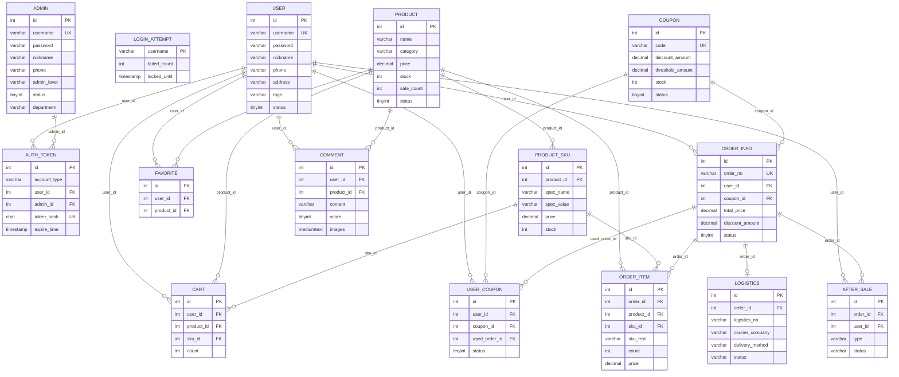

# YZMM_Mall ER 图

数据来源：`src/main/resources/sql/schema.sql` 与后端自动初始化逻辑。

当前数据库已经设置显式外键约束。用 Navicat、DataGrip、MySQL Workbench 等工具反向工程时，订单、商品、用户、购物车、优惠券、售后等关系会自动连线。

纯 Mermaid 文件见：`docs/YZMM_Mall_ER.mmd`。

## 核心关系

| 关系 | 说明 |
| --- | --- |
| `user` | 只保存普通消费者账号和个人资料 |
| `admin` | 独立保存管理员和超级管理员账号 |
| `user` / `admin` → `auth_token` | 登录后生成 token，接口通过 `Authorization: Bearer token` 鉴权 |
| `product` → `product_sku` | 一个商品可拥有多个规格，每个规格独立价格和库存 |
| `user`、`product`、`product_sku` → `cart` | 购物车保留用户选择的商品和规格，支持超时提醒 |
| `coupon` → `user_coupon` → `order_info` | 用户领取优惠券，下单时记录使用的优惠券和优惠金额 |
| `order_info` → `order_item` | 一个订单包含多个商品明细，明细记录购买时的 SKU 文本 |
| `order_info` → `logistics` | 订单发货后生成物流记录，包含快递公司、配送方式、状态 |
| `order_info` → `after_sale` | 已支付订单可以申请退款、退货退款或维修售后 |
| `product` → `comment` | 商品评价支持评分、文字和图片数据 |

## 当前示例数据

| 表名 | 行数 |
| --- | ---: |
| user | 4 |
| admin | 2 |
| product | 20 |
| product_sku | 11 |
| coupon | 3 |
| user_coupon | 6 |
| cart | 7 |
| favorite | 8 |
| order_info | 6 |
| order_item | 10 |
| comment | 18 |
| logistics | 4 |
| after_sale | 2 |

## 设计备注

- `user` 和 `admin` 分表保存：普通用户不会再混在管理员表里，管理员也不会再作为普通用户存储。
- 旧库中残留的 `user.role` 管理员账号和 `admin.user_id` 关联字段会在启动初始化时迁移清理。
- `admin.admin_level` 包含 `admin`、`super_admin`，超级管理员可授权普通用户成为管理员。
- `user.status = 0` 表示禁用普通用户，历史订单保留，禁用账号不能登录。
- `product.status = 0` 表示商品下架，历史订单明细仍保留。
- `user.password` 支持 PBKDF2 哈希；旧明文种子密码会在首次登录成功后自动升级。
- `login_attempt` 用于记录失败次数和锁定时间，减少暴力尝试。
- `cart.update_time` 用于购物车保留倒计时，后端会清理超时项，前端会提前提醒。
- `order_info.total_price` 保存优惠后的应付金额，`discount_amount` 保存优惠金额。
- `schema.sql` 可直接执行，其他成员拉取项目后运行即可得到完整本地数据库。
