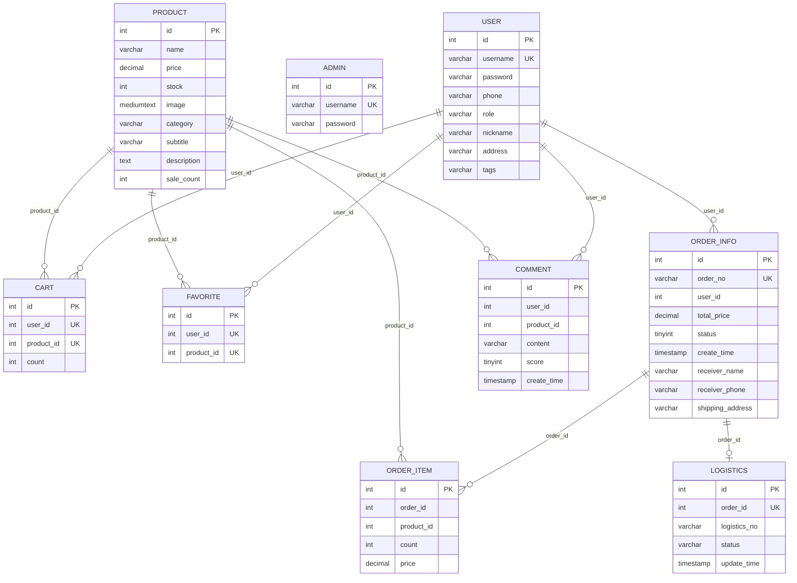

# YZMM_Mall ER 图

数据来源：本机 MySQL 当前 `YZMM_Mall` 数据库结构。

说明：当前数据库已经设置显式外键约束，下面的连线可以由数据库建模工具自动识别。

## 当前数据量

| 表名 | 行数 |
| --- | ---: |
| admin | 1 |
| user | 6 |
| product | 20 |
| cart | 7 |
| favorite | 8 |
| order_info | 6 |
| order_item | 10 |
| comment | 18 |
| logistics | 4 |

## 关键索引

| 表名 | 索引 |
| --- | --- |
| admin | `PRIMARY(id)`, `UNIQUE(username)` |
| user | `PRIMARY(id)`, `UNIQUE(username)` |
| product | `PRIMARY(id)` |
| cart | `PRIMARY(id)`, `UNIQUE(user_id, product_id)` |
| favorite | `PRIMARY(id)`, `UNIQUE(user_id, product_id)` |
| order_info | `PRIMARY(id)`, `UNIQUE(order_no)` |
| logistics | `PRIMARY(id)`, `UNIQUE(order_id)` |

## 外键约束

| 外键名 | 子表字段 | 主表字段 |
| --- | --- | --- |
| fk_cart_user | cart.user_id | user.id |
| fk_cart_product | cart.product_id | product.id |
| fk_favorite_user | favorite.user_id | user.id |
| fk_favorite_product | favorite.product_id | product.id |
| fk_order_info_user | order_info.user_id | user.id |
| fk_order_item_order | order_item.order_id | order_info.id |
| fk_order_item_product | order_item.product_id | product.id |
| fk_comment_user | comment.user_id | user.id |
| fk_comment_product | comment.product_id | product.id |
| fk_logistics_order | logistics.order_id | order_info.id |

## 设计备注

- `user.role` 是当前项目实际使用的权限字段，值包括 `user`、`admin`、`super_admin`。
- `admin` 表目前是独立旧表，和商城业务主流程没有直接关系；后续可以考虑迁移到 `user.role` 统一管理。
- 当前关系字段已经补充数据库级外键约束；正式上线前仍建议配合服务层校验、软删除和操作日志提高数据安全性。
